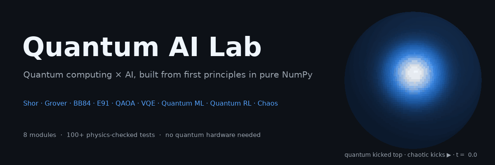
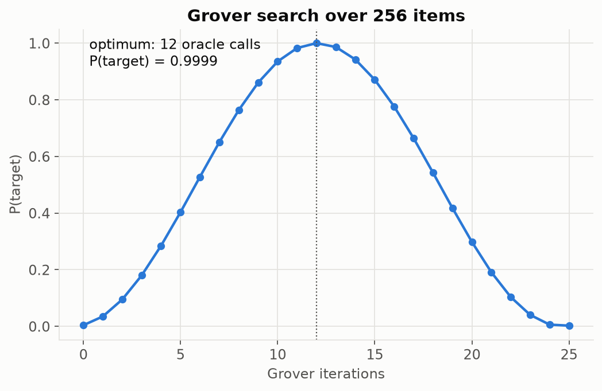
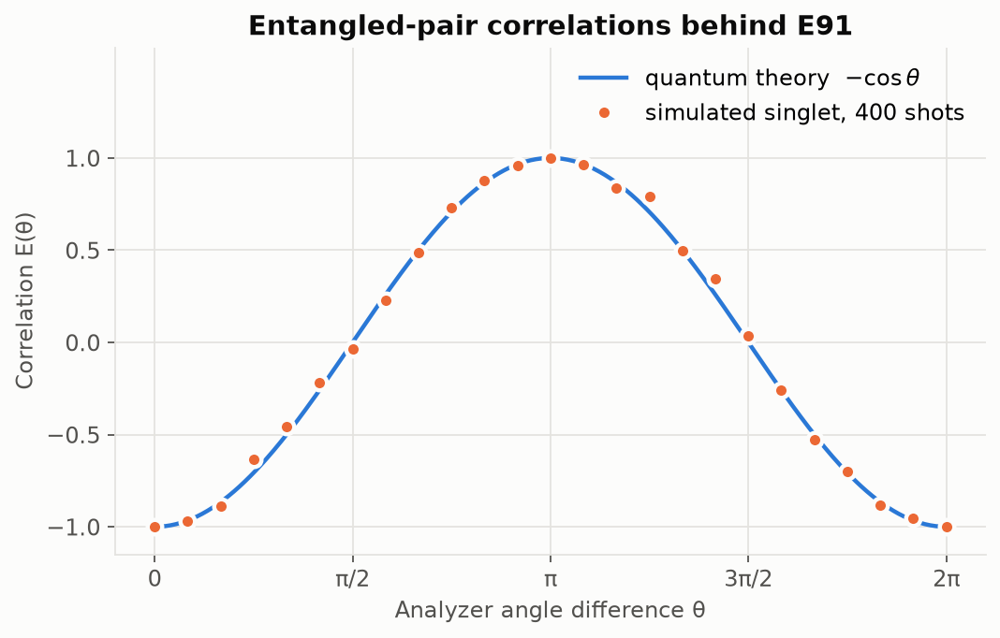
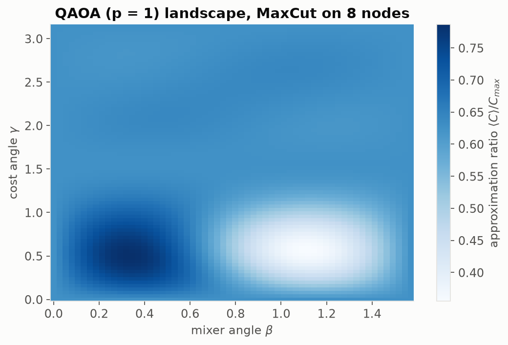
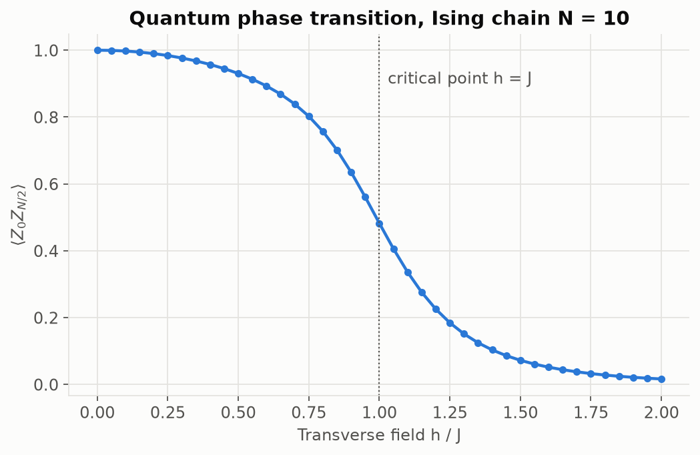
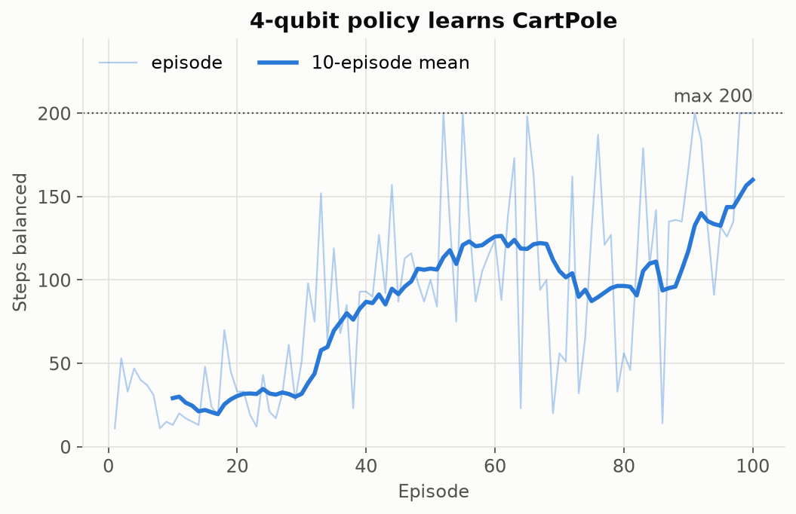
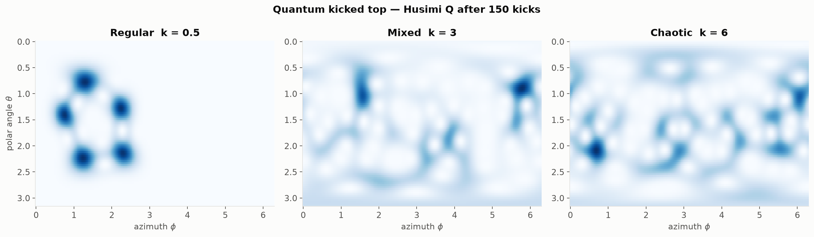
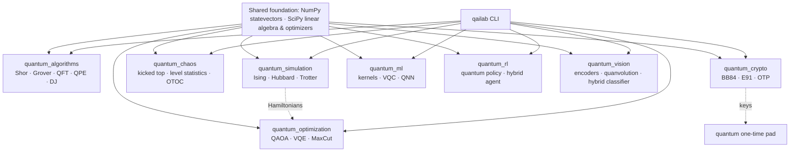

<div align="center">



Shor, Grover, BB84, QAOA, VQE, quantum kernels, quantum RL, quantum chaos and more.<br/>
Eight modules. Every algorithm is a readable statevector simulation you can step through,<br/>
and every headline number below is checked by the test suite.

[](https://github.com/rasidi3112/quantum-ai-lab/actions/workflows/ci.yml)
[](https://python.org)
[](LICENSE)
[](pyproject.toml)
[](https://github.com/astral-sh/ruff)
[](https://mypy-lang.org/)

[Quick start](#-quick-start) · [Gallery](#-gallery) · [Modules](#-modules) · [Verified results](#-verified-results) · [Python API](#-python-api) · [Contributing](#-contributing)

</div>

## ✨ Why this repo

- **No black boxes.** No Qiskit, no PennyLane, no hidden simulator: gates are NumPy arrays, circuits are loops you can read and step through.
- **Breadth.** Algorithms, cryptography, ML, many-body physics, optimization, reinforcement learning, computer vision and quantum chaos, all behind one consistent API.
- **Tested against physics.** 100+ tests compare results with exact solutions: the free-fermion Ising energy, the Hubbard dimer, Tsirelson's bound, Trotter error scaling, GOE level statistics and parameter-shift gradients.
- **Documented and typed.** Every public module, class and function has a NumPy-style docstring with references to the original papers, and the code is fully type-annotated. Ruff and mypy enforce both in CI.
- **Fast enough to play with.** The whole tour runs in about 3 seconds on a laptop CPU.

## 🚀 Quick start

```bash
pip install git+https://github.com/rasidi3112/quantum-ai-lab.git
qailab tour
```

<p align="center">
  
</p>

Then dive into any module:

```bash
qailab list                 # all demos
qailab demo crypto          # BB84 vs. an eavesdropper, E91 Bell test, quantum one-time pad
qailab demo optimization    # constraint-preserving QAOA for portfolio selection
qailab demo rl              # a 4-qubit policy learns to balance CartPole
```

<details>
<summary>Developing locally</summary>

```bash
git clone https://github.com/rasidi3112/quantum-ai-lab.git
cd quantum-ai-lab
pip install -e ".[dev]"
ruff check . && mypy        # lint, docstrings and types
pytest                      # ~20 s
python scripts/make_figures.py   # regenerate the README figures
python scripts/make_banner.py    # regenerate the animated banner
```

</details>

## 🖼 Gallery

Every image and animation is produced from the library itself by [`scripts/make_figures.py`](scripts/make_figures.py), [`make_banner.py`](scripts/make_banner.py) and [`make_terminal_gif.py`](scripts/make_terminal_gif.py).

<table>
<tr>
<td width="50%"><br/><sub><b>Grover search</b>: amplitude amplification peaks at ⌊π/4·√N⌋ oracle calls.</sub></td>
<td width="50%"><br/><sub><b>Entanglement</b>: simulated singlet correlations follow −cos θ, the source of the CHSH violation in E91.</sub></td>
</tr>
<tr>
<td><br/><sub><b>QAOA landscape</b>: approximation ratio over (γ, β) for MaxCut on 8 nodes.</sub></td>
<td><br/><sub><b>Quantum phase transition</b>: long-range order of the transverse-field Ising chain melts at h = J.</sub></td>
</tr>
<tr>
<td><br/><sub><b>Quantum RL</b>: a 16-parameter data-re-uploading circuit learns to balance CartPole.</sub></td>
<td><br/><sub><b>Quantum chaos</b>: the kicked top's Husimi function stays localized when regular and fills the sphere when chaotic. The animated banner is the same simulation, run forward and then time-reversed.</sub></td>
</tr>
</table>

## 🧩 Modules

| Module | What's inside | Demo |
|---|---|---|
| [`quantum_algorithms`](quantum_algorithms/) | Shor (period finding + continued fractions), Grover and amplitude amplification, QFT built from gates, phase estimation, Deutsch–Jozsa | `qailab demo algorithms` |
| [`quantum_crypto`](quantum_crypto/) | BB84 with intercept-resend attack and Toeplitz-hash privacy amplification, E91 with CHSH test, quantum one-time pad (UTF-8 safe) | `qailab demo crypto` |
| [`quantum_ml`](quantum_ml/) | ZZ-feature-map quantum kernels, variational quantum classifier, QNN with parameter-shift gradients | `qailab demo ml` |
| [`quantum_chaos`](quantum_chaos/) | Quantum kicked top and Husimi functions, level-spacing statistics (Wigner–Dyson, Brody, ⟨r⟩ ratio), OTOCs and Lyapunov exponents | `qailab demo chaos` |
| [`quantum_simulation`](quantum_simulation/) | Transverse-field Ising, Fermi–Hubbard via Jordan–Wigner, 1st/2nd/4th-order Trotter–Suzuki | `qailab demo simulation` |
| [`quantum_optimization`](quantum_optimization/) | QAOA with X mixer **and** Hamming-weight-preserving XY mixer, VQE (hardware-efficient, UCCSD), MaxCut | `qailab demo optimization` |
| [`quantum_rl`](quantum_rl/) | Data-re-uploading quantum policy, hybrid classical–quantum REINFORCE agent, CartPole and FrozenLake | `qailab demo rl` |
| [`quantum_vision`](quantum_vision/) | Amplitude, angle, FRQI and NEQR image encodings, quanvolution, hybrid MLP→VQC classifier trained end-to-end with parameter shift | `qailab demo vision` |

## ✅ Verified results

Each row is asserted in [`tests/`](tests/), so CI fails if it ever stops being true.

| Claim | Result | Test |
|---|---|---|
| Shor factors 15, 21, 33, 35, 39, 51, 55, 77, 91 | correct factors; every quantum-found period satisfies aᴿ ≡ 1 (mod N) | `test_shor_factors_semiprimes` |
| Grover on N = 2ⁿ items | P(target) > 0.9 after ⌊π/4·√N⌋ iterations | `test_grover_amplifies_target` |
| QFT from H + controlled-phase + SWAP gates | equals the DFT matrix exactly (n ≤ 5) | `test_qft_is_unitary_and_matches_circuit` |
| BB84 under intercept-resend | QBER ≈ 25%, protocol aborts; clean channel gives matching keys | `test_bb84_detects_intercept_resend` |
| E91 CHSH value | \|S\| ≈ 2√2 (Tsirelson's bound) | `test_e91_violates_chsh_and_keys_agree` |
| Transverse-field Ising ground energy | matches the exact free-fermion solution to 1e-9 | `test_ising_matches_free_fermion_solution` |
| Hubbard dimer at half filling | E₀ = U/2 − √(U²/4 + 4t²) | `test_hubbard_dimer_half_filling_energy` |
| Trotter error | infidelity drops 4×, 16×, 256× when dt halves (orders 1, 2, 4) | `test_trotter_error_scales_with_order` |
| Random-matrix spectra | ⟨r⟩ = 0.531 (GOE) vs 0.386 (Poisson) | `test_ratio_statistic_distinguishes_goe_from_poisson` |
| VQE on 4-site Ising | reaches the exact ground energy to 1e-4 | `test_vqe_reaches_ising_ground_state` |
| XY-mixer QAOA | probability stays 100% inside the budget-feasible subspace | `test_xy_qaoa_stays_in_feasible_subspace` |
| Parameter-shift gradients | agree with finite differences (QNN and hybrid classifier) | `test_qnn_parameter_shift_matches_finite_difference` |

### Constraint-preserving QAOA in one table

From `qailab demo optimization`: choosing 3 of 6 assets (20 valid portfolios out of 64).

| Ansatz (p = 4) | P(valid portfolio) | P(optimal portfolio) |
|---|---|---|
| random guess | 31.2% | 1.6% |
| QAOA, X mixer + penalty term | 43.3% | 2.9% |
| **QAOA, XY mixer from a Dicke state** | **100.0%** | **44.1%** |

## 🐍 Python API

```python
from quantum_algorithms import ShorFactoring, GroverSearch
from quantum_crypto import BB84Protocol, QuantumOTP
from quantum_optimization import QAOA, MaxCutSolver
from quantum_simulation import IsingModel

result = ShorFactoring(seed=1).factor(21)
print(result.factors, result.period_found, result.method)    # (7, 3) 6 quantum period finding

key, stats = BB84Protocol(seed=0).run_protocol(n_qubits=2000, eve_present=True)
print(f"QBER={stats.qber:.1%} secure={stats.protocol_secure}")  # QBER≈25% secure=False

msg = QuantumOTP(seed=0).secure_communicate("Halo dunia 🚀", protocol="e91")
print(msg.decrypted_text, msg.success)                        # Halo dunia 🚀 True

graph = MaxCutSolver.random_graph(8, edge_prob=0.5, seed=1)
print(MaxCutSolver(8).qaoa_solve(graph, p_layers=2, seed=0)["best_cut"])  # 12.0

E0, psi0 = IsingModel(n_sites=8, J=1.0, h=1.0).get_ground_state()
print(f"E0 = {E0:.6f}")                                        # E0 = -10.251662
```

Constraint-preserving QAOA on any diagonal cost function:

```python
import numpy as np
from quantum_optimization import QAOA

costs = np.random.default_rng(0).normal(size=2**6)           # one cost per bitstring
result = QAOA(6, seed=0).optimize_hamiltonian(
    costs, p_layers=4, mixer="xy", hamming_weight=3, method="L-BFGS-B"
)
samples = QAOA.sample_solution(result["state"], n_samples=1000, seed=0)
```

## 🏗 Architecture



Each package is self-contained, so you can read one module without the others. More detail in [docs/architecture.md](docs/architecture.md).

## 📐 Under the hood

| Concept | Formula | Where |
|---|---|---|
| State vector | \|ψ⟩ = Σᵢ αᵢ \|i⟩ | everywhere |
| Grover iterate | G = (2\|s⟩⟨s\| − I)·O_f | `quantum_algorithms/grover.py` |
| Quantum kernel | K(x, y) = \|⟨φ(x)\|φ(y)⟩\|² | `quantum_ml/qkernel.py` |
| CHSH | S = E(a,b) − E(a,b′) + E(a′,b) + E(a′,b′), \|S\| ≤ 2 classically | `quantum_crypto/e91.py` |
| Trotter–Suzuki | e^{−i(A+B)t} ≈ (e^{−iAt/2n} e^{−iBt/n} e^{−iAt/2n})ⁿ | `quantum_simulation/trotter.py` |
| QAOA | \|γ,β⟩ = Πₖ e^{−iβₖB} e^{−iγₖC} \|ψ₀⟩ | `quantum_optimization/qaoa.py` |
| Parameter shift | ∂⟨O⟩/∂θ = ½[⟨O⟩(θ+π/2) − ⟨O⟩(θ−π/2)] | `quantum_ml`, `quantum_vision` |
| OTOC | C(t) = ⟨[W(t), V]†[W(t), V]⟩ | `quantum_chaos/lyapunov.py` |

Statevector simulation scales as 2ⁿ, so the demos stay at 4–12 qubits. That is the point: small enough to inspect every amplitude.

## 🗺 Roadmap

- [ ] Noise models (depolarizing, amplitude damping) and error-mitigation demos
- [ ] Optional Qiskit / PennyLane backends to run the same circuits on real hardware
- [ ] Interactive notebooks for every module
- [ ] Publish to PyPI

Ideas and pull requests are welcome: see the [good first issues](CONTRIBUTING.md#good-first-issues).

## 🤝 Contributing

Contributions of new algorithms, demos, tests and docs are welcome. Read [CONTRIBUTING.md](CONTRIBUTING.md), then run `ruff check . && pytest` before opening a pull request.

If this project helped you learn or teach quantum computing, consider giving it a ⭐. It helps others find it.

## 📚 Citation

If you use Quantum AI Lab in research or teaching, please cite it via the [CITATION.cff](CITATION.cff) file (GitHub's "Cite this repository" button).

## 📖 References

1. Nielsen & Chuang, *Quantum Computation and Quantum Information* (2010).
2. Shor, Polynomial-time algorithms for prime factorization and discrete logarithms, *SIAM J. Comput.* 26 (1997).
3. Grover, A fast quantum mechanical algorithm for database search, *STOC* (1996).
4. Bennett & Brassard, Quantum cryptography: public key distribution and coin tossing (1984); Ekert, *PRL* 67, 661 (1991).
5. Farhi, Goldstone & Gutmann, A quantum approximate optimization algorithm, arXiv:1411.4028 (2014).
6. Hadfield et al., From the quantum approximate optimization algorithm to a quantum alternating operator ansatz, *Algorithms* 12, 34 (2019).
7. Havlíček et al., Supervised learning with quantum-enhanced feature spaces, *Nature* 567, 209 (2019).
8. Pérez-Salinas et al., Data re-uploading for a universal quantum classifier, *Quantum* 4, 226 (2020).
9. Jerbi et al., Parametrized quantum policies for reinforcement learning, *NeurIPS* (2021).
10. Henderson et al., Quanvolutional neural networks, *Quantum Mach. Intell.* 2, 2 (2020).
11. Haake, *Quantum Signatures of Chaos* (2010); Atas et al., *PRL* 110, 084101 (2013).

## 📄 License

[MIT](LICENSE)
